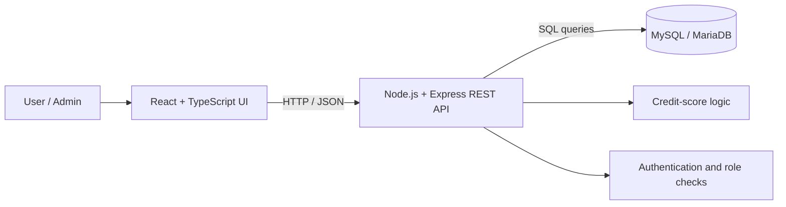

<div align="center">

# 🏦 Banking Management & Credit Score Web Application

### Full-stack bachelor's degree project · React · TypeScript · Node.js · Express · MySQL

**A web platform for managing bank accounts, tracking transactions, and estimating creditworthiness.**

[](https://react.dev/)
[](https://www.typescriptlang.org/)
[](https://nodejs.org/)
[](https://expressjs.com/)
[](https://www.mysql.com/)

**[Repository](https://github.com/elidiana2002/Licenta)**

</div>

---

## 📌 Overview

This academic project explores how a modern web application can help users understand and organize their personal financial information. It combines banking account management, transaction tracking, and a **rule-based, illustrative credit-score calculation** in a single interface.

The system was developed as a bachelor's diploma project at the **University of Oradea, Faculty of Electrical Engineering and Information Technology, Computer Science program**.

> **Disclaimer:** This is an educational banking simulation, **not** a real banking service, licensed credit-scoring system, or lending decision engine. Its estimated score must not be used as a real-world credit eligibility assessment.

## ✨ Main features

| Area | Description |
| --- | --- |
| 🔐 Authentication | User registration and login; JWT-based authorization and user roles described in the thesis. |
| 👤 Accounts | View and manage bank accounts associated with a client; account types, currencies, IBANs and balances. |
| 💳 Cards | Database support for payment cards and card status management. |
| 💸 Transactions | Track account activity and transfers between accounts. |
| 📊 Credit score | Estimate a simplified financial indicator using income, expenses and debt. |
| 📜 History | Record account-related changes and transaction events. |
| 🛠️ Administration | Administrative workflows and monitoring described in the thesis. |

The project documentation and database schema describe these modules. **Actual availability of each screen and endpoint depends on the checked-out source version.**

## 🧰 Technology stack

| Layer | Technologies |
| --- | --- |
| Frontend | React, TypeScript, Tailwind CSS |
| Backend | Node.js, Express, REST API |
| Database | MySQL / MariaDB-compatible SQL |
| Authentication | JWT, password hashing described in documentation |
| Development | npm, Visual Studio Code, Git, GitHub |

## 🏗️ Architecture



### Database model

The supplied `banca.sql` export contains the following tables:

| Table | Purpose |
| --- | --- |
| `clients` | Client profiles and role information |
| `banks` | Bank reference data |
| `accounts` | Bank accounts, balances, IBANs and currency |
| `cards` | Card attributes, type and status |
| `transactions` | Transaction records and transfers |
| `history` | Change and event history |
| `saved_recipients` | Stored transfer recipients |

The database export also contains a procedure and triggers. Some terminology differs between the academic explanation and the actual SQL schema: for example, the SQL table is named **`clients`**, not `users`.

## 🧮 Credit-score concept

The presentation introduces the following simplified financial indicator:

```text
Estimated indicator = income − expenses − (2 × debts)
```

For example, income of 5,000 RON, expenses of 2,500 RON and debts of 800 RON produce an indicator of **900**.

This is a project-specific heuristic, not a standardized credit bureau score, statistical default-probability model, or validated bank scoring methodology. **The written thesis includes a differently signed expression in another section; the presentation formula is shown here, and the actual implementation should be checked against the source code.**

## 🚀 Running locally

### Prerequisites

- Node.js and npm
- MySQL or a compatible MariaDB server
- A database administration tool (optional: phpMyAdmin / MySQL Workbench)

### 1. Clone the project

```bash
git clone https://github.com/elidiana2002/Licenta.git
cd Licenta
```

### 2. Set up the database

Create an empty local database:

```sql
CREATE DATABASE banca CHARACTER SET utf8mb4 COLLATE utf8mb4_general_ci;
```

Import a **sanitized, schema-only** database export that matches your current application version. The supplied development dump contains sample client records, password hashes, identification fields, card numbers and CVV values; **do not publish or distribute that raw dump**.

### 3. Install and start the application

The precise frontend/backend folder names, environment-variable names and npm scripts must be checked in the repository's `package.json` files before publishing a runnable setup guide. In each relevant Node.js project directory, the typical install command is:

```bash
npm install
```

Then configure local database connectivity and the JWT secret using a local `.env` file (never commit real credentials). Run the scripts **actually defined by the project**, such as a frontend development script or backend start script.

> **Setup verification needed:** Add the exact working commands and required `.env` variable names once confirmed from the source code. Do not assume `npm start`, `npm run dev`, or a fixed localhost port without checking the project.

## 📸 Screenshots

Add real application screenshots to a repository folder such as `docs/screenshots/`, then replace the placeholders below:

| Screen | Suggested image |
| --- | --- |
| Landing page | `docs/screenshots/home.png` |
| Authentication | `docs/screenshots/login.png` |
| Banking dashboard | `docs/screenshots/dashboard.png` |
| Credit-score calculator | `docs/screenshots/credit-score.png` |
| Transactions and transfers | `docs/screenshots/transactions.png` |

Screenshots should use **synthetic demonstration data only** and must not expose personal details, real card information or authentication tokens.

## 🔒 Security and limitations

This application was developed as a Bachelor's Degree Project at the University of Oradea, Faculty of Electrical Engineering and Information Technology, specializing in Computer Science.

The primary objective is to demonstrate full-stack web development, database management, banking operations simulation, and credit scoring algorithms rather than to provide a production-ready banking platform.
Security Mechanisms

The project documentation describes several fundamental security mechanisms:

    JWT Authentication – Token-based authentication for managing user sessions and accessing protected API endpoints.

    Password Hashing (bcrypt) – Passwords are stored as hashes rather than plaintext.

    Role-Based Access Control (RBAC) – Different permission levels for users, managers, and administrators.

    Input Validation – Validation of user inputs to reduce malformed requests and common security risks.

    Parameterized SQL Queries – Designed to reduce the risk of SQL injection.

    Activity Logging – Tracking account operations and changes for monitoring and debugging.

These mechanisms are described in the project's documentation and are not independently verified through a comprehensive security audit.
Known Limitations

As an academic prototype, the application does not aim to implement every security requirement expected from a real financial institution.

Advanced security measures such as brute-force protection, multi-factor authentication (MFA), advanced fraud detection, and production infrastructure hardening are outside the current scope of the project.

The demonstration database also includes simulated payment-card information, including card verification codes (CVV). Such information must not be retained after authorization in real payment systems. Any future production-oriented development would require redesigning this component and implementing appropriate payment security standards.
Disclaimer

This project is intended exclusively for educational, demonstration, and portfolio purposes.

It is not connected to real banking infrastructure, does not process real financial transactions, and has not undergone a formal security audit or PCI DSS compliance assessment.

The application should not be deployed in a production banking environment or used to store sensitive personal or financial information without substantial security improvements.

The focus of this project is on demonstrating software engineering concepts, full-stack application architecture, relational database operations, and the implementation of a simulated banking management system.

## 🗺️ Future improvements

- Align the credit-score definition and sign conventions throughout the documentation and application.
- Improve automated tests and document verified test coverage.
- Add fully reproducible setup instructions and a safe seed dataset.
- Strengthen validation, auditing, error handling and security controls.
- Expand reporting, analytics and accessibility features.
- Prepare a secure deployment configuration for a publicly accessible demonstration.

## 🎓 Academic details

**Project:** *Dezvoltarea unei aplicații web pentru gestionarea creditelor bancare*  
**Author:** Pușcaș Eli-Madian  
**University:** University of Oradea  
**Faculty:** Faculty of Electrical Engineering and Information Technology  
**Program:** Computer Science (*Calculatoare*)  
**Scientific coordinator:** Prof. Dr. Ing. Cornelia Aurora Györödi

The written dissertation provided with this project is dated **2025**, while the supplied presentation is labeled **2026**. Both source documents are retained as provided.

## 📄 License

No software license has been verified for this repository. **Do not assume an open-source license solely because the source is visible on GitHub.** Add a `LICENSE` file if you want to explicitly permit reuse and distribution.

---

<div align="center">

**Created as an academic full-stack project.**  
[GitHub – elidiana2002](https://github.com/elidiana2002)

</div>
